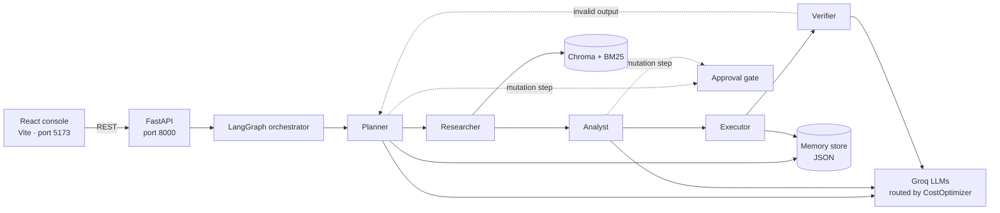

# Autonomous Multi-Agent AI Business Intelligence & Execution System

A multi-agent platform that takes a plain-English business goal, breaks it into a plan, and runs it through specialised agents that **research**, **analyse**, **execute** and **verify** each step. It combines hybrid RAG over your own documents, persistent per-user memory, prompt-injection guardrails, human approval for risky actions, and cost-aware model routing, all behind a FastAPI backend and a React dashboard.

---

## Features

| Area | What it does |
|------|--------------|
| **Multi-agent orchestration** | A LangGraph state machine routes work between Planner, Researcher, Analyst, Executor and Verifier agents. |
| **Hybrid RAG** | Dense vector search (Chroma + `BAAI/bge-large-en-v1.5`) merged with BM25 keyword search over uploaded PDFs, text, CSV, Excel files and URLs. |
| **Contradiction detection** | Flags when retrieved evidence comes from multiple sources so the Analyst can reconcile conflicting figures. |
| **Persistent memory** | Per-user store of instructions (with priority), verified business info and completed tasks, retrieved by relevance on every request. |
| **Human-in-the-loop** | Any plan step marked `is_mutation` pauses at an approval gate until the user approves it in the UI. |
| **Security guardrails** | Regex-based prompt-injection scan on user requests and on retrieved document chunks (malicious chunks are redacted, not passed to the model). |
| **Cost optimisation** | Task-based model routing, a one-hour result cache, and live token and cost tracking with a baseline comparison. |
| **Web console** | React dashboard with an agent console, cost metrics, memory manager, drag-and-drop document upload and local search history. |

---

## Architecture



**Request flow**

1. `POST /api/run-orchestration` scans the request for prompt injection, then starts the graph.
2. The **Planner** loads the user's instructions and relevant memories and asks an LLM for a JSON task list (`task_id`, `agent`, `description`, `is_mutation`). If the model's output can't be parsed, a safe three-step default plan is used.
3. The **router** sends each task to the matching agent. A mutation task stops the graph at the **approval gate** and returns `awaiting_approval`.
4. After the user approves, `POST /api/resume-orchestration` continues from the executor.
5. The **Verifier** checks the output for unsupported conclusions. An invalid result routes back to the Planner for another attempt (up to `max_retries`).

### Agents

| Agent | Responsibility | Model tier (see `cost_optimizer.py`) |
|-------|----------------|--------------------------------------|
| Planner | Turns the request plus memory into a task list | `qwen/qwen3.8-27b` |
| Researcher | Hybrid RAG retrieval, caching, contradiction check | none (retrieval only) |
| Analyst | Calculations and a reconciled JSON summary of the evidence | `qwen/qwen3.8-27b` |
| Executor | Performs the action, writes results and audit entries to memory | `openai/gpt-oss-120b` |
| Verifier | Validates the output and decides whether to replan | `openai/gpt-oss-120b` |

`llama-3.1-8b-instant` is the lightweight fallback for any other task type.

---

## Tech stack

**Backend:** Python, FastAPI, Uvicorn, Pydantic, LangChain, LangGraph, Groq (`langchain-groq`), ChromaDB, `rank-bm25`, HuggingFace embeddings, PyPDF, Unstructured, pandas

**Frontend:** React 18, Vite 5, Motion (animation), plain CSS

---

## Project structure

```
.
├── backend/
│   ├── main.py                # FastAPI app and all REST endpoints
│   ├── graph.py               # LangGraph workflow, router, approval gate
│   ├── agents.py              # Planner, Researcher, Analyst, Executor, Verifier
│   ├── agent_state.py         # Shared AgentState schema
│   ├── rag_engine.py          # Ingestion, hybrid retrieval, contradiction check
│   ├── memory_manager.py      # Persistent per-user memory (JSON file)
│   ├── security_guardrails.py # Prompt-injection detection and chunk sanitising
│   ├── cost_optimizer.py      # Model routing, caching, cost metrics
│   ├── requirements.txt
│   └── .env                   # API keys (not committed)
└── agent-console/
    ├── src/
    │   ├── App.jsx            # Shell, navigation, user ID switcher
    │   ├── api.js             # Backend client
    │   ├── useHistory.js      # Per-user search history (localStorage)
    │   └── components/        # Console, Metrics, Memory, Documents, HistoryPanel ...
    ├── design-system/MASTER.md
    └── package.json
```

Runtime data is created on first run: `db/chroma_db/` (vector index), `db/memory_store.json` (memory) and `uploads/` (uploaded files).

---

## Getting started

### Prerequisites

- Python 3.10+
- Node.js 18+
- A [Groq](https://console.groq.com) API key

### 1. Backend

```bash
cd backend
python -m venv .venv
source .venv/bin/activate        # Windows: .venv\Scripts\activate
pip install -r requirements.txt
```

Create a `.env` file in `backend/`:

```env
GROQ_API_KEY=your_groq_api_key

# Optional: LangSmith tracing
LANGCHAIN_TRACING_V2=true
LANGCHAIN_ENDPOINT=https://api.smith.langchain.com
LANGCHAIN_API_KEY=your_langsmith_key
LANGCHAIN_PROJECT=multi-agent-bi
```

Start the server:

```bash
python main.py
```

The API runs at `http://127.0.0.1:8000` and interactive docs are at `http://127.0.0.1:8000/docs`.

> The first start downloads the `BAAI/bge-large-en-v1.5` embedding model (over 1 GB), so it can take a few minutes.

### 2. Frontend

```bash
cd agent-console
npm install
npm run dev
```

Open `http://localhost:5173`. To point the UI at a different backend, set `VITE_API_URL` (for example in `.env.local`):

```env
VITE_API_URL=http://127.0.0.1:8000
```

Production build: `npm run build`, then `npm run preview`.

---

## Using the console

1. **Documents:** drag in PDFs, `.txt`/`.md`, CSV or Excel files. They are chunked (500 characters, 50 overlap) and indexed.
2. **Agents:** describe a goal, for example *"Analyze last quarter's sales and recommend three actions"*. Watch the plan and agent messages appear, and approve any step that needs it.
3. **Memory:** add standing instructions such as *"Always report costs in USD"* with a priority, search what the system remembers, or delete entries.
4. **Cost:** view token use, spend, cache hit rate and the baseline comparison.

Use the **User ID** box in the sidebar to switch between separate memory profiles.

---

## API reference

| Method | Endpoint | Description |
|--------|----------|-------------|
| `POST` | `/api/run-orchestration` | Run the full agent workflow. Body: `request`, `user_id`, `completed_task_ids`, `simulate_api_failure`. |
| `POST` | `/api/resume-orchestration` | Resume after approval with the saved plan, step index, research and analysis data. |
| `POST` | `/api/upload-documents` | Multipart upload (`files`); saves and indexes the documents. |
| `POST` | `/api/ingest-documents` | Index files already on the server (`file_paths`) or web pages (`urls`). |
| `GET`  | `/api/cost-metrics` | Live token, cost and cache statistics. |
| `GET`  | `/api/benchmarks` | Baseline vs optimised comparison. |
| `GET`  | `/api/memory/get/{user_id}` | Full memory for a user. |
| `POST` | `/api/memory/relevant` | Memory entries relevant to a query. |
| `POST` | `/api/memory/instruction` | Add a prioritised instruction. |
| `POST` | `/api/memory/delete` | Delete memory by type and key. |

**Example**

```bash
curl -X POST http://127.0.0.1:8000/api/run-orchestration \
  -H "Content-Type: application/json" \
  -d '{"request": "Summarize customer feedback and propose fixes", "user_id": "demo"}'
```

A request that matches an injection pattern returns `final_state.status = "blocked_security"` and never reaches the model.

---

## Security notes

- `SecurityGuardrails` checks for phrases such as "ignore previous instructions" and "reveal system prompt" in both user input and retrieved chunks. It is pattern-based, so treat it as a first layer rather than complete protection.
- Never commit `.env`. Add it to `.gitignore` and rotate any key that has been shared.
- CORS is currently open (`*`) for local development. Restrict `allow_origins` before deploying.

---

